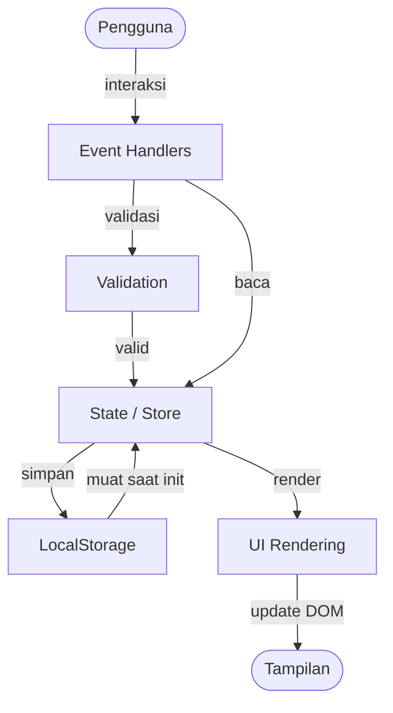

# Design Document

## Overview

Expense & Budget Visualizer adalah aplikasi web mobile-first yang memungkinkan pengguna melacak pemasukan dan pengeluaran harian. Seluruh aplikasi berjalan di browser tanpa backend — data disimpan di LocalStorage, antarmuka dalam bahasa Indonesia, nilai mata uang dalam format IDR.

Arsitektur yang digunakan adalah **flat single-file architecture**: satu file HTML (`index.html`), satu stylesheet (`css/app.css`), dan satu file JavaScript (`js/app.js`). Tidak ada modul ES, tidak ada build tools, tidak ada library eksternal. Semua logika berada dalam `js/app.js` yang diorganisir menggunakan fungsi dan objek biasa dengan komentar seksi yang jelas.

Grafik pengeluaran per kategori diimplementasikan menggunakan **CSS bar chart berbasis `div`** dengan lebar proporsional (percentage width), atau **inline SVG** — tidak menggunakan Canvas API.

---

## Architecture

### Struktur File

```
index.html        ← Single HTML file; struktur halaman, semua section UI
css/app.css       ← Semua styling: layout responsif, dark/light theme, komponen
js/app.js         ← Semua logika aplikasi dalam satu file
```

### Organisasi `js/app.js`

File JavaScript dibagi menjadi seksi dengan komentar pembatas yang jelas:

```
// ============================================================
// SECTION 1: CONSTANTS & DEFAULT DATA
// ============================================================
// ============================================================
// SECTION 2: STATE / STORE
// ============================================================
// ============================================================
// SECTION 3: LOCALSTORAGE UTILITIES
// ============================================================
// ============================================================
// SECTION 4: DATA UTILITIES (pure functions)
// ============================================================
// ============================================================
// SECTION 5: FORMATTING UTILITIES (pure functions)
// ============================================================
// ============================================================
// SECTION 6: VALIDATION (pure functions)
// ============================================================
// ============================================================
// SECTION 7: UI RENDERING
// ============================================================
// ============================================================
// SECTION 8: CHART RENDERING (CSS bar chart / SVG)
// ============================================================
// ============================================================
// SECTION 9: EVENT HANDLERS
// ============================================================
// ============================================================
// SECTION 10: APP INIT
// ============================================================
```

### Alur Data



**Prinsip utama:**
- State terpusat di satu objek global `AppState`
- Setiap perubahan state diikuti pemanggilan fungsi render yang relevan
- Tidak ada event bus atau pub/sub — event handler memanggil fungsi render secara langsung
- Fungsi utilitas bersifat pure (tidak mengubah state global)

---

## Components and Interfaces

### State Global (`AppState`)

```javascript
var AppState = {
  transactions: [],    // Array<Transaction>
  categories: [],      // Array<string> — termasuk default + kustom
  theme: 'light',      // 'light' | 'dark'
  activeView: 'dashboard', // 'dashboard' | 'history' | 'chart' | 'monthly'
  activeMonthFilter: null  // 'YYYY-MM' | null
};
```

### Struktur Data: Transaction

```javascript
{
  id: string,          // timestamp-based unique ID, e.g. "txn_1698765432100"
  amount: number,      // nilai positif (IDR)
  type: string,        // 'income' | 'expense'
  category: string,    // nama kategori
  date: string,        // format 'YYYY-MM-DD' (ISO untuk sorting)
  description: string  // opsional, bisa kosong
}
```

### Antarmuka HTML (Sections)

| Section HTML | Fungsi |
|---|---|
| `#section-dashboard` | Kartu saldo, total pemasukan/pengeluaran, form tambah transaksi |
| `#section-history` | Daftar riwayat transaksi, tombol hapus |
| `#section-chart` | CSS/SVG bar chart pengeluaran per kategori + legenda |
| `#section-monthly` | Ringkasan bulanan, daftar transaksi per bulan |
| `#section-categories` | Daftar kategori, form tambah kategori kustom |
| `#nav-bar` | Tab navigasi bawah (mobile) / header nav (desktop) |
| `#theme-toggle` | Tombol toggle dark/light mode |

### Fungsi-Fungsi Kunci

**LocalStorage Utilities:**
- `loadFromStorage()` → memuat semua data saat init
- `saveTransactions()` → menyimpan `AppState.transactions` ke localStorage
- `saveCategories()` → menyimpan `AppState.categories` ke localStorage
- `saveTheme(theme)` → menyimpan preferensi tema
- `checkLocalStorageAvailable()` → deteksi ketersediaan localStorage, tampilkan peringatan jika tidak tersedia

**Data Utilities (pure):**
- `calculateBalance(transactions)` → `number`
- `calculateTotalByType(transactions, type)` → `number`
- `groupByMonth(transactions)` → `Array<MonthSummary>`
- `filterByMonth(transactions, monthKey)` → `Array<Transaction>`
- `computeChartData(transactions)` → `Array<{category, amount, percentage}>`
- `sortByDateDesc(transactions)` → `Array<Transaction>`

**Formatting Utilities (pure):**
- `formatIDR(amount)` → `string` — contoh: `"Rp 150.000"`
- `formatDate(isoDateString)` → `string` — contoh: `"25/10/2024"`

**Validation (pure):**
- `validateTransaction(formData)` → `{valid: boolean, errors: string[]}`
- `validateCategoryName(name, existingCategories)` → `{valid: boolean, error: string}`

**UI Rendering:**
- `renderDashboard()` — render kartu saldo + form
- `renderTransactionList(transactions)` — render riwayat
- `renderChart()` — render bar chart CSS/SVG
- `renderMonthly()` — render ringkasan bulanan
- `renderCategories()` — render daftar kategori
- `renderAll()` — memanggil semua fungsi render (digunakan saat init)
- `showError(elementId, message)` / `clearError(elementId)` — tampilkan/hapus pesan error inline

**Event Handlers:**
- `handleAddTransaction(event)` — submit form transaksi
- `handleDeleteTransaction(id)` — hapus transaksi
- `handleAddCategory(event)` — submit form kategori kustom
- `handleDeleteCategory(name)` — hapus kategori kustom (dengan konfirmasi)
- `handleThemeToggle()` — toggle dark/light
- `handleNavigation(view)` — switch antara section

**App Init:**
- `init()` — dipanggil saat `DOMContentLoaded`: load data dari localStorage, terapkan tema, render semua, pasang event listener

---

## Data Models

### Transaction (tersimpan di localStorage)

```json
{
  "id": "txn_1698765432100",
  "amount": 150000,
  "type": "expense",
  "category": "Makanan & Minuman",
  "date": "2024-10-25",
  "description": "Makan siang"
}
```

### Category Store (tersimpan di localStorage)

```json
["Makanan & Minuman", "Transportasi", "Tagihan & Utilitas", "Hiburan", "Kesehatan", "Belanja", "Lain-lain", "Gym"]
```

Array berisi kategori default + kategori kustom pengguna. Urutan pertama selalu 7 kategori default.

### Theme Preference

```
localStorage key: "ebv_theme"
value: "light" | "dark"
```

### localStorage Keys

| Key | Konten |
|---|---|
| `"ebv_transactions"` | JSON array of Transaction |
| `"ebv_categories"` | JSON array of string |
| `"ebv_theme"` | `"light"` atau `"dark"` |

### Monthly Summary (computed, tidak disimpan)

```javascript
{
  key: "2024-10",         // 'YYYY-MM'
  label: "Oktober 2024",  // string tampilan
  income: 5000000,
  expense: 2300000,
  net: 2700000,
  transactions: []        // filtered transaction list
}
```

### Chart Data (computed, tidak disimpan)

```javascript
{
  category: "Makanan & Minuman",
  amount: 450000,
  percentage: 35.5    // persentase dari total pengeluaran
}
```

---

## Correctness Properties

*A property is a characteristic or behavior that should hold true across all valid executions of a system — essentially, a formal statement about what the system should do. Properties serve as the bridge between human-readable specifications and machine-verifiable correctness guarantees.*

### Property 1: Validasi transaksi menolak semua input tidak valid

*For any* kombinasi nilai form transaksi di mana jumlah bernilai nol, negatif, atau bukan angka valid, `validateTransaction()` SHALL mengembalikan `valid: false` dengan pesan kesalahan dalam bahasa Indonesia, dan tidak ada data yang tersimpan ke state atau localStorage.

**Validates: Requirements 1.3, 1.4, 1.5**

### Property 2: Format tanggal selalu DD/MM/YYYY

*For any* string tanggal ISO yang valid (format `YYYY-MM-DD`), `formatDate()` SHALL mengembalikan string yang cocok dengan pola `DD/MM/YYYY` di mana DD adalah dua digit hari, MM adalah dua digit bulan, dan YYYY adalah empat digit tahun.

**Validates: Requirements 1.6**

### Property 3: Format mata uang selalu diawali "Rp" dan menggunakan titik sebagai pemisah ribuan

*For any* bilangan bulat positif, `formatIDR()` SHALL mengembalikan string yang diawali `"Rp "` dan menggunakan titik (`.`) sebagai pemisah ribuan sesuai konvensi IDR.

**Validates: Requirements 1.7, 2.1, 2.2**

### Property 4: Kalkulasi saldo selalu akurat secara aritmetika

*For any* array transaksi dengan jumlah dan tipe yang beragam, `calculateBalance()` SHALL mengembalikan nilai yang sama persis dengan `sum(amount where type='income') - sum(amount where type='expense')`.

**Validates: Requirements 2.1, 2.2**

### Property 5: Warna tampilan saldo mencerminkan tanda nilai saldo

*For any* nilai saldo yang dikalkulasi dari daftar transaksi, jika saldo negatif maka elemen DOM saldo SHALL memiliki class CSS yang mengindikasikan warna merah; jika saldo nol atau positif SHALL memiliki class CSS yang mengindikasikan warna hijau atau netral.

**Validates: Requirements 2.4, 2.5**

### Property 6: Pengurutan riwayat transaksi selalu newest-first

*For any* array transaksi dengan tanggal yang beragam, `sortByDateDesc()` SHALL mengembalikan array dengan elemen yang sama (panjang identik, tidak ada elemen hilang) dan diurutkan dari tanggal paling baru ke paling lama.

**Validates: Requirements 3.1**

### Property 7: Render transaksi selalu memuat semua informasi wajib

*For any* objek transaksi yang valid, `renderTransactionList()` SHALL menghasilkan HTML yang memuat: nilai IDR terformat, label tipe (pemasukan/pengeluaran), nama kategori, tanggal terformat DD/MM/YYYY, dan deskripsi jika tidak kosong; serta class CSS yang berbeda untuk income vs expense.

**Validates: Requirements 3.3, 3.4**

### Property 8: Persentase chart data selalu menjumlahkan ke 100%

*For any* daftar transaksi pengeluaran yang tidak kosong, `computeChartData()` SHALL mengembalikan array di mana jumlah semua `percentage` sama dengan 100 (toleransi pembulatan floating-point ±0.01), dan setiap `percentage` sama dengan `(category_total / overall_total) * 100`.

**Validates: Requirements 4.1, 4.4**

### Property 9: Penambahan kategori kustom menggunakan perbandingan case-insensitive

*For any* nama kategori yang sudah ada dalam daftar (dalam variasi huruf besar/kecil apapun), `validateCategoryName()` SHALL mengembalikan error duplikasi. *For any* nama kategori yang benar-benar baru dan tidak hanya berisi spasi, penambahan SHALL berhasil dan kategori muncul di `AppState.categories`.

**Validates: Requirements 5.2, 5.3, 5.4**

### Property 10: Penghapusan kategori kustom memindahkan transaksi ke "Lain-lain"

*For any* nama kategori kustom dan *for any* daftar transaksi yang sebagian atau seluruhnya menggunakan kategori tersebut, setelah `handleDeleteCategory()` dikonfirmasi: (a) kategori tidak lagi ada di `AppState.categories`, dan (b) semua transaksi yang sebelumnya menggunakan kategori tersebut kini memiliki `category === "Lain-lain"`.

**Validates: Requirements 5.5**

### Property 11: Persistensi data round-trip mempertahankan semua transaksi dan kategori

*For any* set transaksi dan kategori kustom yang tersimpan ke localStorage melalui `saveTransactions()` dan `saveCategories()`, pemanggilan `loadFromStorage()` SHALL menghasilkan state yang identik: jumlah transaksi sama, semua field identik, semua kategori kustom tersedia.

**Validates: Requirements 8.1, 8.2, 8.4**

### Property 12: Toggle tema adalah operasi idempoten saat diulang dua kali

*For any* tema awal (`'light'` atau `'dark'`), memanggil `handleThemeToggle()` dua kali SHALL menghasilkan tema yang sama dengan tema awal (round-trip). Setiap pemanggilan tunggal SHALL mengubah tema ke nilai yang berlawanan dan menyimpannya ke localStorage.

**Validates: Requirements 7.2, 7.3**

### Property 13: Pengelompokan bulanan mencakup semua transaksi tanpa duplikasi

*For any* array transaksi dengan tanggal yang tersebar di berbagai bulan, `groupByMonth()` SHALL menghasilkan daftar bulan yang: (a) total semua transaksi di semua bulan sama dengan jumlah transaksi input, (b) tidak ada transaksi yang muncul di lebih dari satu bulan, (c) setiap `income` dan `expense` per bulan secara aritmetika benar, dan (d) diurutkan dari bulan terbaru ke terlama.

**Validates: Requirements 6.1, 6.2, 6.4**

### Property 14: Filter bulan hanya mengembalikan transaksi dari bulan yang dipilih

*For any* month key `YYYY-MM` dan *for any* array transaksi, `filterByMonth(transactions, monthKey)` SHALL mengembalikan hanya transaksi yang tanggalnya berada dalam bulan dan tahun yang sesuai — tidak ada transaksi dari bulan lain yang ikut, dan tidak ada transaksi dari bulan tersebut yang terlewat.

**Validates: Requirements 6.3**

---

## Error Handling

### Validasi Form Transaksi

Error ditampilkan secara inline di bawah field yang bermasalah, menggunakan `showError(elementId, message)`. Semua pesan error dalam bahasa Indonesia. Form tidak disimpan jika ada error. Error dihapus saat pengguna mulai mengisi ulang field.

Kasus error yang ditangani:
- Jumlah kosong → `"Jumlah tidak boleh kosong"`
- Jumlah bukan angka → `"Jumlah harus berupa angka"`
- Jumlah ≤ 0 → `"Jumlah harus lebih dari nol"`
- Kategori tidak dipilih → `"Pilih kategori transaksi"`
- Tanggal kosong → `"Tanggal tidak boleh kosong"`

### Validasi Kategori Kustom

- Nama kosong / hanya spasi → `"Nama kategori tidak boleh kosong"`
- Duplikasi (case-insensitive) → `"Kategori '[nama]' sudah ada"`

### LocalStorage Tidak Tersedia

Saat `init()`, panggil `checkLocalStorageAvailable()`. Jika localStorage tidak tersedia (misalnya mode private di beberapa browser lama), tampilkan banner peringatan di atas halaman:
> "Peringatan: Data tidak dapat disimpan karena penyimpanan lokal browser tidak tersedia."

Aplikasi tetap berfungsi secara in-memory selama sesi tersebut.

### Penghapusan Kategori Kustom

Sebelum menghapus, tampilkan `window.confirm()` dengan pesan:
> "Hapus kategori '[nama]'? Semua transaksi dengan kategori ini akan dipindahkan ke 'Lain-lain'."

Jika dibatalkan, tidak ada perubahan state.

### Data Korup di LocalStorage

Saat `loadFromStorage()`, bungkus `JSON.parse()` dalam `try-catch`. Jika parsing gagal, gunakan state default kosong dan tampilkan pesan peringatan. Jangan crash aplikasi.

---

## Testing Strategy

Karena aplikasi ini adalah Vanilla JS tanpa framework atau build tools, pendekatan pengujian mengutamakan **fungsi pure yang dapat diuji langsung** dan **property-based testing untuk logika inti**.

### Pendekatan Testing

**1. Property-Based Testing (untuk logika bisnis inti)**

Library yang digunakan: **fast-check** (dapat dimuat langsung via `<script src>` dari CDN, tanpa npm — misal dari unpkg). Setiap property test dikonfigurasi dengan minimum **100 iterasi**.

Setiap property test diberi tag dalam komentar:
```javascript
// Feature: expense-budget-visualizer, Property N: <deskripsi singkat>
```

Property yang diimplementasikan sebagai test:
- Property 1: Validasi transaksi menolak semua input tidak valid
- Property 2: Format tanggal selalu DD/MM/YYYY
- Property 3: Format mata uang selalu diawali "Rp" dan pakai titik ribuan
- Property 4: Kalkulasi saldo selalu akurat secara aritmetika
- Property 5: Warna saldo mencerminkan tanda nilai
- Property 6: Pengurutan transaksi selalu newest-first
- Property 7: Render transaksi memuat semua informasi wajib
- Property 8: Persentase chart data menjumlahkan ke 100%
- Property 9: Validasi duplikasi kategori case-insensitive
- Property 10: Penghapusan kategori memindahkan transaksi ke "Lain-lain"
- Property 11: Round-trip persistensi data mempertahankan semua data
- Property 12: Toggle tema adalah operasi round-trip
- Property 13: Pengelompokan bulanan tanpa duplikasi dan akurat
- Property 14: Filter bulan hanya mengembalikan transaksi yang relevan

**2. Unit Tests (example-based, untuk kasus spesifik)**

Test kasus spesifik yang tidak dicakup property:
- 7 kategori default tersedia saat init
- Empty state: tidak ada transaksi → pesan kosong ditampilkan
- LocalStorage unavailable → banner peringatan muncul
- Toggle tema saat tidak ada preferensi tersimpan → gunakan `prefers-color-scheme`
- Navigasi antar section berfungsi

**3. Smoke Tests (manual)**

Dilakukan secara manual sebelum rilis:
- Buka `index.html` langsung via `file://` — aplikasi berfungsi penuh tanpa server
- Tampilan responsif di viewport 320px, 768px, 1440px
- Semua elemen interaktif memiliki area sentuh minimal 44×44px (cek via DevTools)
- Load time < 3 detik pada koneksi standar (cek via Lighthouse)
- Grafik tidak menggunakan Canvas API (cek via code review)

### Struktur Test File

Test dapat ditulis dalam satu file `test/app.test.html` yang dimuat langsung di browser — mengimpor `js/app.js` dan fast-check via CDN script tag. Tidak diperlukan runner tambahan.
